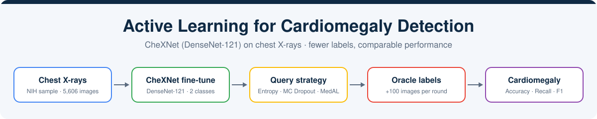
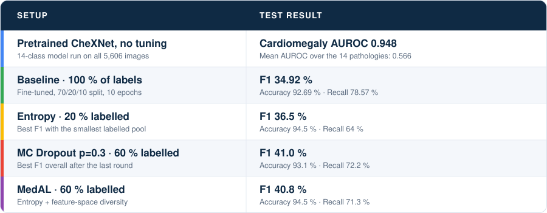
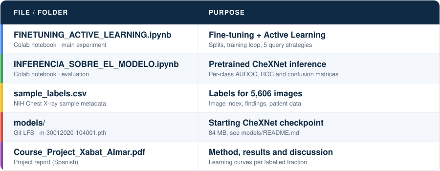

<p align="center"></p>

<p align="center">
  
  
  
  
  
  
  
</p>

# Active Learning for Cardiomegaly Detection

Course project by **Xabat Arin Mendizabal** and **Aimar Hernandez**.

Deep learning has shown great potential for detecting diseases in medical images, but its development requires large amounts of labeled data. This project explores Active Learning strategies to reduce annotation requirements while maintaining performance, using a CheXNet-based model (DenseNet-121) to detect cardiomegaly in chest X-rays. The data is a 5,606-image sample of NIH ChestX-ray14 with a strong class imbalance: only 141 positives (2.52 %).

## How it works

1. **Pretrained inference.** The 14-class CheXNet checkpoint is run on the whole sample to check which pathology it already separates best; cardiomegaly stands out with an AUROC of 0.948.
2. **Binary fine-tuning.** The classifier head is replaced by a 2-class layer; only `denseblock4`, `norm5` and the new head are unfrozen. Adam (10⁻³ head, 10⁻⁴ backbone), cosine annealing, class-weighted cross-entropy, batch size 16, `XRaysPolicy` augmentation, 256 → 224 crops.
3. **Fixed splits.** A stratified 10 % test set never takes part in training or querying. The remaining 90 % is divided into labeled pools of 20 %, 30 %, 50 % and 60 % (10 % of each kept for validation); the rest is the unlabeled pool.
4. **Active Learning loop.** Five rounds per strategy: train for 10 epochs, evaluate Accuracy / Recall / F1 on the test set, score the unlabeled pool, and move the top **100** images to the labeled set (simulated oracle).
5. **Query strategies.** Random, Margin, Entropy, MC Dropout (Dropout2d p = 0.3 after `norm5`, T = 20 passes) and MedAL (entropy pre-filter + feature-space diversity).
6. **Baseline.** The same model trained conventionally with 100 % of the labels (70/20/10 split, 10 epochs) as reference.

## Results



Last-round test metrics for every strategy, as **(Accuracy, Recall, F1)** in %, from the project report:

| Method | 20 % labeled | 30 % labeled | 60 % labeled |
|---|---|---|---|
| Random | (93, 64, 31.8) | (89.5, 85.7, 28.9) | (92.2, 60.3, 38.6) |
| Margin | (92, 64, 31.8) | (92.3, 71.4, 31.7) | (92, 69.8, 37.9) |
| Entropy | **(94.5, 64, 36.5)** | (92.5, 64.3, 30) | (93.4, 67.3, 39.1) |
| MC Dropout 0.3 | (95, 50, 33.5) | (94.1, 50, 29.8) | **(93.1, 72.2, 41)** |
| MedAL | (92, 57, 26.2) | (90, 85.7, 30) | (94.5, 71.3, 40.8) |
| Baseline (100 %) | (92.69, 78.57, 34.92) | (92.69, 78.57, 34.92) | (92.69, 78.57, 34.92) |

Accuracy barely moves between methods, so F1 and Recall are the informative metrics. With only 20 % of the labels, Entropy sampling already beats the fully supervised baseline on F1; with 60 %, MC Dropout, MedAL, Entropy and Random all exceed it. The curves fluctuate noticeably from round to round because each positive image added or missed has a large effect at a 2.5 % prevalence. Learning curves for each scenario are in `Course_Project_Xabat_AImar.pdf`.

## Repository structure



## Getting started

Both notebooks were written and executed in **Google Colab** with a GPU runtime (Tesla T4), so they are not meant to be run as plain local scripts. They rely on PyTorch, torchvision, scikit-learn, pandas, NumPy, Matplotlib, seaborn and Pillow, all preinstalled in Colab.

**1. Get the code and the CheXNet weights.** The checkpoints are about 85 MB, above GitHub's 50 MB recommended limit, so they are tracked with [Git LFS](https://git-lfs.com/) via `.gitattributes`:

```bash
git clone https://github.com/xabat111/ActiveLearningCardiomegaly.git
cd ActiveLearningCardiomegaly
git lfs install
git lfs pull
```

From a Colab cell:

```python
!apt-get -qq install git-lfs
!git clone https://github.com/xabat111/ActiveLearningCardiomegaly.git
%cd ActiveLearningCardiomegaly
!git lfs install
!git lfs pull
```

**2. Prepare the data.** Upload the NIH Chest X-ray sample images and `sample_labels.csv` to your Google Drive.

**3. Open a notebook in Colab** and select a GPU runtime (Runtime → Change runtime type → GPU):

- [FINETUNING_ACTIVE_LEARNING.ipynb](https://colab.research.google.com/github/xabat111/ActiveLearningCardiomegaly/blob/main/FINETUNING_ACTIVE_LEARNING.ipynb) — fine-tuning of CheXNet and the Active Learning loop.
- [INFERENCIA_SOBRE_EL_MODELO.ipynb](https://colab.research.google.com/github/xabat111/ActiveLearningCardiomegaly/blob/main/INFERENCIA_SOBRE_EL_MODELO.ipynb) — inference with the pretrained checkpoint, ROC curves and per-image predictions.

The notebooks start by mounting Google Drive:

```python
from google.colab import drive
drive.mount('/content/drive')
```

**4. Point the path variables** defined in the first cell at your own folders:

- `CSV_PATH` — location of `sample_labels.csv`
- `IMAGES_DIR` — folder containing the PNG images
- `MODEL_PATH` — starting CheXNet checkpoint (`models/m-30012020-104001.pth`)

Running outside Colab works too, but you have to drop the `drive.mount` cell and point those same variables at local paths.

`models/README.md` explains how the two kinds of checkpoint are loaded and how to publish new weights, either pushing straight from Colab with Git LFS or attaching them to a GitHub Release.

## Future work

- **Repeated runs with several seeds** to put confidence intervals on the curves and tell real gains apart from the round-to-round fluctuations caused by the 2.5 % prevalence.
- **Report the 50 % scenario.** The notebook already builds that split and includes a cell to run it, but its numbers are not yet summarised alongside 20/30/60 %.
- **Tune MC Dropout.** Compare several dropout rates (e.g. p = 0.5 against the current 0.3) and numbers of stochastic passes to calibrate the epistemic uncertainty estimate.
- **Imbalance-aware querying and thresholds.** Optimise the decision threshold for F1 and add class-balance terms to the acquisition score, since precision is what holds F1 back.
- **Assisted oracle.** When an uncertain image is sent for annotation, show the most similar already-labeled X-rays to speed up the radiologist and reduce bias.
- **Cheaper retraining.** Fine-tune only on newly queried samples instead of the whole labeled pool, and move the Colab code into reusable scripts with configurable paths.

## License

Released under the [MIT License](LICENSE). The CheXNet starting checkpoint and training code are adapted from [nasir6/chexnet](https://github.com/nasir6/chexnet); the images come from the NIH ChestX-ray14 dataset, subject to their own terms.
